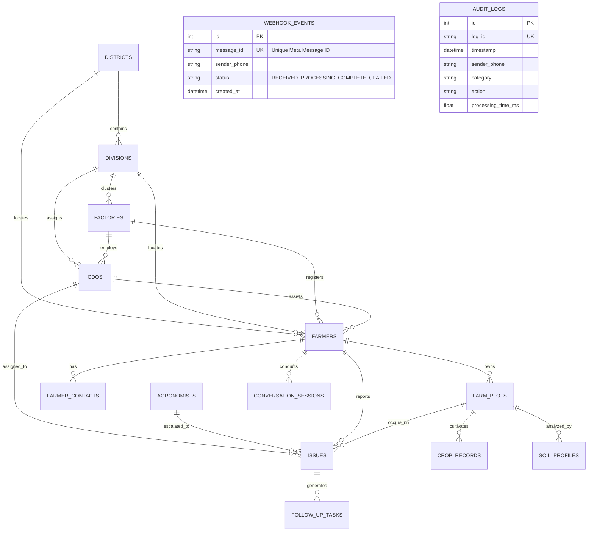

# SYSTEM ARCHITECTURE: AGRICULTURAL SUPPORT & COORDINATION AUTOMATION

**System:** AI-Powered Farmer Communication and Agricultural Support Automation System  
**Current State:** Phase 1 Stabilised Baseline  
**Target State:** Complete Multi-Stakeholder Automation Platform (Phases 1–7)  

---

## 1. As-Is Architecture (Phase 1 Stabilised Baseline)

The system is structured as an asynchronous FastAPI application paired with an in-memory/Excel data layer and a local ChromaDB vector store, now fortified with defensive ingress validation, double-layer deduplication, and resilient model loading:

```
+-------------------------------------------------------------------------+
|                        META WHATSAPP CLOUD API                          |
|                       (Incoming Webhook Events)                         |
+------------------------------------+------------------------------------+
                                     |
                                     v HTTP POST /webhook
+-------------------------------------------------------------------------+
|                  FASTAPI GATEWAY (gateway/webhook_server.py)             |
|                                                                         |
|  - Webhook verification (GET /webhook) without credential logging       |
|  - Defensive JSON & structure validation (HTTP 400 on malformed payloads)|
|  - Immediate ingress deduplication (deque maxlen=1000)                  |
|  - Safe handling of non-text media messages (audio/images/videos)        |
|  - Immediate 200 OK response (<10ms)                                    |
|  - Background task scheduling with try/except error isolation           |
+------------------------------------+------------------------------------+
                                     |
                                     v (Background Task)
+-------------------------------------------------------------------------+
|                  FARMER AGENT & CLASSIFIER LAYER                        |
|                                                                         |
|  1. Farmer Profile Lookup: ExcelProfileManager (data/farmer_profiles.xlsx)|
|  2. Message Classifier (agent/classifier.py):                           |
|     - Regex pattern heuristics (Greeting, Spam, Form, Distress, Query)  |
|     - If Noise/Spam -> Silently Drop (No WhatsApp output)               |
|     - If Form -> Send Google Form Link                                  |
|     - If Distress -> Dispatch Emergency Helpline                        |
|     - If Query -> Forward to RAG Engine                                 |
+------------------------------------+------------------------------------+
                                     |
                                     v
+------------------------------------+------------------------------------+
|               RAG & INFERENCE PIPELINE (rag/pipeline.py)                |
|                                                                         |
|  1. Resilient Model Loading: checks local HuggingFace cache first,      |
|     falls back to download if allowed, or raises actionable error       |
|  2. Query Expansion: AGRI_SYNONYMS dictionary (Hindi/Hinglish to English)|
|  3. Dense Vector Retrieval: ChromaDB SQLite store (data/chroma_db)      |
|  4. Hybrid Scoring: Cosine distance + Domain lexical keyword boost      |
|  5. LLM Synthesis (agent/llm_client.py):                                |
|     - Google Gemini 1.5 Flash REST API                                  |
|     - Offline fallback: Extractive rule-based parsing                   |
|  6. Response Formatter: WhatsApp single-asterisk formatting             |
+------------------------------------+------------------------------------+
                                     |
                                     v
+------------------------------------+------------------------------------+
|                   DELIVERY & AUDIT TRACKING                             |
|                                                                         |
|  - WhatsApp Dispatcher: WhatsAppCloudClient (gateway/whatsapp_client.py)|
|    with E.164 phone number validation and PII-masked logging            |
|  - Audit Logger: AuditLogger deque with failure tracking                |
|  - Visual Dashboard: HTML/Tailwind/Chart.js (gateway/templates/dashboard.html)|
+-------------------------------------------------------------------------+
```

---

## 2. To-Be Target System Architecture (Phases 1–7)

The target architecture replaces ephemeral in-memory state and flatfiles with a resilient relational database, a stateful multi-turn conversation orchestrator, multimodal processors, and automated CDO/agronomist workflows.

```
                        +----------------------------+
                        |  FARMERS, CDOs, EXPERTS    |
                        |      (WhatsApp / Web)      |
                        +--------------+-------------+
                                       |
                                       v
         +---------------------------------------------------------+
         |               INGRESS / EGRESS GATEWAY                  |
         |  - Meta WhatsApp Cloud API (v21.0)                      |
         |  - Media Downloader (Audio, Photos, Video)              |
         |  - Signature Verification & HMAC Security               |
         |  - Redis / DB Persistent Idempotency & Deduplication    |
         +-----------------------------+---------------------------+
                                       |
                                       v
         +---------------------------------------------------------+
         |          MULTIMODAL & MULTILINGUAL ENGINE               |
         |  - Language Identifier: Marathi, Hindi, English, Mixed  |
         |  - Voice STT: Marathi / Hindi Audio Transcription       |
         |  - Vision Diagnostic: Plant symptom feature extractor   |
         |  - Video Processing: Keyframe extraction & analysis     |
         +-----------------------------+---------------------------+
                                       |
                                       v
         +---------------------------------------------------------+
         |            CENTRAL CONVERSATION ORCHESTRATOR            |
         |  - Intent Classifier (13 Granular Categories)           |
         |  - Persistent Session Manager (Stateful Multi-Turn)     |
         |  - Missing Agronomic Parameter Detective                |
         |  - Conversational Data Collection Engine                |
         |  - Grounded RAG Knowledge Retriever                     |
         |  - Tool Action Dispatcher (Safe DB Services)            |
         +---------+-------------------+-----------------+---------+
                   |                   |                 |
                   v                   v                 v
+----------------------+     +-----------------+   +---------------+
| CDO COORDINATION     |     | AGRONOMIST      |   | RAG KNOWLEDGE |
| - Factory routing    |     | ESCALATIONS     |   | - ChromaDB    |
| - Missing data alerts|     | - Expert triage |   | - Semantic    |
| - Follow-up engine   |     | - Review portal |   | - Lexical re-rank|
+----------+-----------+     +--------+--------+   +---------------+
           |                          |
           +------------+-------------+
                        |
                        v
         +---------------------------------------------------------+
         |                 PERSISTENT DATA LAYER                   |
         |  - PostgreSQL / Relational Database (SQLAlchemy)        |
         |  - Farmers, Profiles, Crops, Soil Data                  |
         |  - CDOs, Agronomists, Factory/Division Mapping          |
         |  - Issues, Escalations, Conversation History, Logs     |
         +-----------------------------+---------------------------+
                                       |
                                       v
         +---------------------------------------------------------+
         |          COORDINATOR OPERATIONS DASHBOARD               |
         |  - Live Operational KPI & Issue Stream                  |
         |  - Farmer Registry & Missing Field Verification         |
         |  - CDO Directory & Escalation Handoff Controls          |
         |  - Human Review / Safe Message Approval Gate            |
         +---------------------------------------------------------+
```

---

## 3. Data Flow Traces

### Flow 1: Farmer Agricultural Inquiry
1. Farmer sends text or voice message in Marathi: *"कांद्यावर करपा आला आहे, कोणती फवारणी करू?"*
2. **Ingress:** Webhook receives payload, checks signature, writes incoming event to persistent DB, queues background task, and returns HTTP 200.
3. **Multimodal Processing:** If voice, STT converts audio to text transcript. Language detector flags `Marathi (mr)`.
4. **Classification:** Intent classified as `CROP_DISEASE_PEST_QUERY`.
5. **Session Resolution:** Active session retrieved by phone number. Farmer identified as Ramesh Patil, District: Nashik, Crop: Onion.
6. **RAG Retrieval:** Query expanded with Marathi agronomic synonyms (`करपा -> purple blotch storage rot onion`). ChromaDB retrieves top 3 grounded chunks.
7. **Synthesis:** System prompt supplied with farmer profile, Marathi instruction, and retrieved literature. LLM generates grounded Marathi recommendation with dosage (e.g., *Mancozeb 75% WP @ 2.5 g/L* or *Carbendazim 50% WP @ 1 g/L*).
8. **Delivery & Audit:** Output formatted for WhatsApp and delivered. Interaction recorded in `conversation_records` and `audit_logs`.

### Flow 2: Automated Farm Parameter Collection
1. System recognizes that farmer Ramesh Patil has missing parameters: `planting_date`, `npk_values`, `planting_season`.
2. When the farmer interacts, the agent responds to the primary query first, then gently asks: *"दादा, तुमच्या कांदा पिकाची लागवड कोणत्या तारखेला झाली होती?"*
3. Farmer replies: *"गेल्या महिन्याच्या 15 तारखेला लागवड केली"* (Planting was on 15th of last month).
4. Information Extraction module parses date (`2026-10-15`), validates it, updates `farm_profiles.planting_date` with status `UNVERIFIED_FARMER_INPUT`.
5. System acknowledges and records the state, progressing to the next pending field (`npk_values`) in subsequent turns.

### Flow 3: CDO Coordination for Missing Critical Data
1. System detects that farmer is missing sugar factory register ID or soil fertility report required for cane harvesting scheduling.
2. Central Coordinator routes ticket to assigned CDO for the division/factory:
   - Message to CDO: *"CDO साहेब, शेतकरी Popat Rao (गाव: Niphad) यांची माती परीक्षण माहिती व ऊस लागवड तारीख अद्ययावत करणे बाकी आहे. कृपया पडताळणी करावी."*
3. CDO verifies on-site and replies with verified values.
4. System updates farmer record to `VERIFIED` with source `CDO_INPUT` and updates timestamp.

### Flow 4: Agronomist Escalation
1. Farmer uploads photograph of severely wilted sugarcane with red discoloration in internal stem tissue.
2. Vision model identifies symptoms consistent with Red Rot (*Colletotrichum falcatum*), a catastrophic pathogen.
3. System classifies issue as `URGENT_DISEASE_ESCALATION` (High Priority).
4. System creates record in `issues` table with status `ASSIGNED_TO_AGRONOMIST`, attaches photo evidence and farmer profile, and sends an alert to the on-duty agronomist.
5. Farmer receives interim message: *"तुमच्या उसाच्या पिकाची लक्षणे गंभीर दिसत आहेत. आमचे कृषी तज्ज्ञ यावर तात्काळ तपासणी करत असून लवकरच मार्गदर्शन करतील."*
6. Agronomist reviews via coordinator dashboard, confirms fungicide/field management advice, and approves dispatch.

---

## 4. Phase 2 Relational Database Architecture & Schema (Implemented)

The database is built using SQLAlchemy 2.0 ORM with native support for PostgreSQL (production target via psycopg2) and SQLite (local development and automated testing). Migrations are tracked using Alembic.

### 4.1 Entity Relationship Diagram (ERD)



### 4.2 Normalized Database Schema

#### 1. Administrative & Organizational Hierarchy
- **`districts`**: `id` (PK), `name` (String 100, Unique, Indexed), `state` (String 100), `created_at`.
- **`divisions`**: `id` (PK), `name` (String 100, Indexed), `district_id` (FK -> `districts.id`), `created_at`. Unique constraint: `("district_id", "name")`.
- **`factories`**: `id` (PK), `name` (String 150), `code` (String 50, Unique, Indexed), `division_id` (FK -> `divisions.id`), `phone_number`.
- **`cdos`**: `id` (PK), `cdo_code` (String 50, Unique, Indexed), `name` (String 150), `phone_number` (String 20, Unique, Indexed), `email`, `factory_id` (FK -> `factories.id`), `division_id` (FK -> `divisions.id`), `is_active` (Boolean).
- **`agronomists`**: `id` (PK), `name` (String 150), `phone_number` (String 20, Unique, Indexed), `email`, `specialization` (String 150), `is_active` (Boolean).

#### 2. Farmer Master & Contact Layer
- **`farmers`**:
  - `id`: Integer PK
  - `farmer_id`: String(50), Unique, Indexed (e.g. `FARM-00001`)
  - `full_name`: String(150), Indexed
  - `primary_phone`: String(20), Unique, Indexed (10-digit normalized)
  - `alternate_phone`: String(20), Nullable
  - `village`, `tehsil`: String(100)
  - `district_id` (FK -> `districts.id`), `division_id` (FK -> `divisions.id`), `factory_id` (FK -> `factories.id`), `assigned_cdo_id` (FK -> `cdos.id`)
  - `preferred_language`: String(20), default `'mr'`
  - Field Statuses: `name_status`, `village_status`, `tehsil_status` (Enum: `VERIFIED`, `UNVERIFIED`, `MISSING`, `NEEDS_CORRECTION`)
  - Provenance: `data_source`, `supplied_by`, `created_at`, `last_updated_at`, `verified_at`, `verified_by`.
- **`farmer_contacts`**: `id` (PK), `farmer_id` (FK -> `farmers.id`, Cascade Delete), `contact_name`, `phone_number` (Indexed), `relationship_type` (Self, Son, Brother, CDO), `is_primary`, `notes`.

#### 3. Multi-Plot Agricultural Holdings, Crops & Soils
- **`farm_plots`**:
  - `id`: Integer PK
  - `farmer_id`: FK -> `farmers.id`, Indexed (Cascade Delete)
  - `plot_identifier`: String(50), e.g. `PLOT-1`, `GAT-142`
  - `land_area`: Float, `area_unit` (Enum: `ACRES`, `GUNTHAS`, `HECTARES`)
  - `has_drip_irrigation`: Boolean
  - `water_source`: String (Well, Borewell, Canal, River)
  - Statuses: `area_status`, `irrigation_status`
  - Unique constraint: `("farmer_id", "plot_identifier")`.
- **`crop_records`**:
  - `id`: Integer PK
  - `farm_plot_id`: FK -> `farm_plots.id`, Indexed (Cascade Delete)
  - `crop_name`: String(100), Indexed (Sugarcane, Onion, Cotton, Wheat, etc.)
  - `crop_variety`: String(100) (Co 86032, CoM 0265, Phule Samarth)
  - `planting_date`: Date, Nullable
  - `planting_season`: Enum (`SURU`, `ADSALI`, `PRE_SEASONAL`, `KHARIF`, `RABI`, `SUMMER`, `OTHER`)
  - `growth_stage`: String(100)
  - `is_current`: Boolean
  - Statuses: `crop_status`, `variety_status`, `planting_date_status`, `season_status`, `stage_status`.
- **`soil_profiles`**:
  - `id`: Integer PK
  - `farm_plot_id`: FK -> `farm_plots.id`, Indexed (Cascade Delete)
  - `soil_type`: String(100) (Black Cotton, Medium Black, Clay Loam)
  - `soil_fertility`: String(100) (Low, Medium, High)
  - `ph_level`: Float, `ec_level`: Float, `organic_carbon_pct`: Float
  - `nitrogen_n_kg_ha`: Float, `phosphorus_p_kg_ha`: Float, `potassium_k_kg_ha`: Float
  - `soil_health_card_number`: String(100)
  - Statuses: `soil_type_status`, `fertility_status`, `npk_status`.

#### 4. Coordination, Conversation Sessions, Tasks & Deduplication
- **`conversation_sessions`**: `id` (PK), `session_id` (Unique, Indexed), `farmer_id` (FK -> `farmers.id`), `phone_number` (Indexed), `current_state`, `pending_fields` (Text/JSON), `context_data` (Text/JSON), `last_interaction_at`.
- **`issues`**: `id` (PK), `issue_code` (Unique, Indexed, e.g. `ISS-202611-0001`), `farmer_id` (FK), `farm_plot_id` (FK), `category`, `priority` (Enum: `LOW`, `MEDIUM`, `HIGH`, `CRITICAL`), `status` (Enum: `OPEN`, `INVESTIGATING`, `ESCALATED_CDO`, `ESCALATED_AGRONOMIST`, `RESOLVED`, `CLOSED`), `title`, `description`, `media_urls`, `assigned_cdo_id` (FK), `assigned_agronomist_id` (FK), `resolution_notes`, `resolved_at`.
- **`follow_up_tasks`**: `id` (PK), `task_code` (Unique, Indexed), `issue_id` (FK), `target_role` (Enum: `FARMER`, `CDO`, `AGRONOMIST`), `target_phone`, `description`, `due_date`, `status` (Enum: `PENDING`, `IN_PROGRESS`, `COMPLETED`, `OVERDUE`, `CANCELLED`), `reminder_count`, `last_reminder_at`.
- **`audit_logs`**: `id` (PK), `log_id` (Unique, Indexed), `timestamp` (Indexed), `sender_name`, `sender_phone` (Indexed), `district`, `group_id`, `group_name`, `incoming_text`, `category` (Indexed), `action`, `bot_reply`, `rag_sources` (Text/JSON), `processing_time_ms`, `is_escalated`, `resolved`.
- **`webhook_events`**: `id` (PK), `message_id` (Unique, Indexed), `sender_phone` (Indexed), `event_type`, `payload_hash`, `status` (Enum: `RECEIVED`, `PROCESSING`, `COMPLETED`, `FAILED`, `DUPLICATE`), `retry_count`, `error_message`, `created_at`, `completed_at`.

### 4.3 Clean Repository & Service Architecture

The system enforces a clean separation of concerns:
```
           +---------------------------------------+
           |     FastAPI Gateway & Farmer Agent    |
           +-------------------+-------------------+
                               |
                               v
           +---------------------------------------+
           |             Service Layer             |
           |  - FarmerService                      |
           |  - DeduplicationService               |
           |  - ExcelMigrationService              |
           +-------------------+-------------------+
                               |
                               v
           +---------------------------------------+
           |           Repository Layer            |
           |  - FarmerRepository                   |
           |  - CDORepository                      |
           |  - IssueRepository                    |
           |  - AuditRepository                    |
           |  - IdempotencyRepository              |
           +-------------------+-------------------+
                               |
                               v
           +---------------------------------------+
           |     SQLAlchemy 2.0 ORM & SQLite/PG     |
           +---------------------------------------+
```
